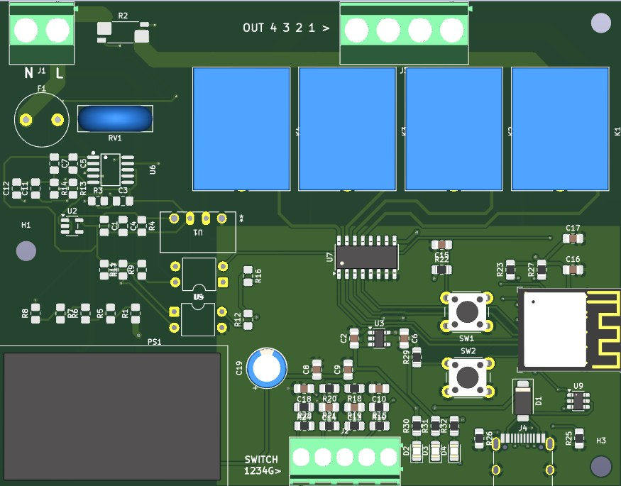
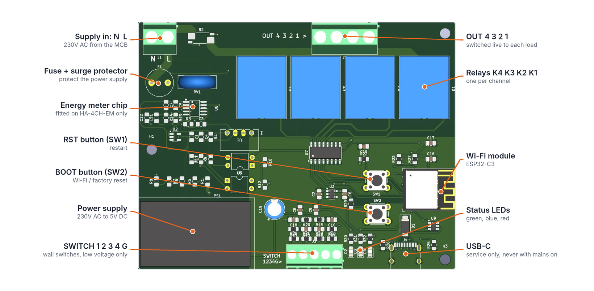
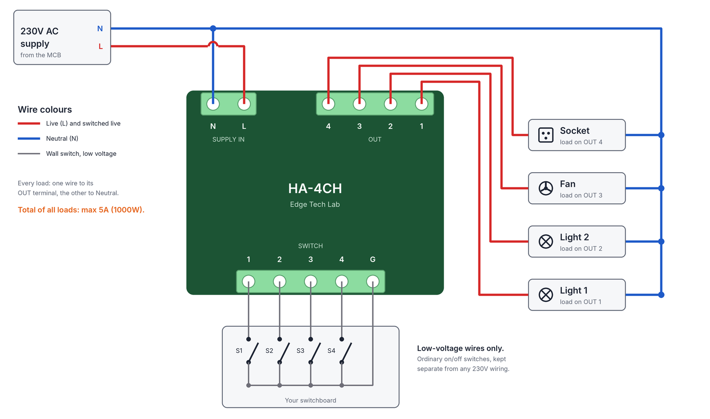

# HA-4CH Smart Switch

**ESP32-C3 based 4-channel smart switch** by [Edge Tech Lab](https://edgetechlab.pages.dev) — control 4 loads from a phone app, by voice (Google Assistant / Alexa) or from existing wall switches.

<p align="center">
  
</p>

## Features

- 4 relay channels (10A 250V AC contacts), **5A total board rating (~1000W)**
- ESP RainMaker app control over Wi-Fi, BLE provisioning with a per-board QR code
- Google Assistant and Amazon Alexa voice control
- 4 low-voltage wall-switch inputs, synced with the app
- Power-cut memory: every channel returns to its last state
- Schedules and scenes from the app
- Over-the-air (OTA) firmware updates
- Energy-monitoring variant (HA-4CH-EM) with BL0942: voltage, current, power, kWh

## Hardware

| Block | Part |
| --- | --- |
| MCU / Wi-Fi + BLE | ESP32-C3 module |
| Mains to 5V | Hi-Link HLK-PM01 (5V 0.6A), 1A fuse + MOV on input |
| Relays | 4 × Songle SRD-05VDC-SL-C, driven by ULN2003 |
| Energy meter (EM) | BL0942 with 1 mΩ Kelvin shunt, B0505S isolated supply, PC817 optocouplers |
| USB | USB-C with USBLC6-2SC6 ESD protection (programming / service) |
| Indicators | Green (power), blue (Wi-Fi), red (status) LEDs; RST and BOOT buttons |

### GPIO map

| Function | GPIO |
| --- | --- |
| Relay 1–4 | 4, 5, 6, 7 (HIGH = on) |
| Wall switch 1–4 | 0, 1, 3, 10 (active low, external pull-ups) |
| Blue LED / Red LED | 8 / 2 (active low) |
| BOOT button | 9 |

## Board layout



## Wiring



> ⚠️ **230V mains.** Install inside an enclosure, switch off the MCB before wiring, and keep the total load under 5A. Wall-switch terminals are low voltage only.

## Repository structure

```
HA-4CH-Smart-Switch/
├── hardware/      KiCad project (schematic, PCB, libraries)
├── images/        renders, layout and wiring diagrams
└── README.md
```

Open `hardware/*.kicad_pro` in **KiCad 8 or newer**.

## Status

- [x] PCB v1 fabricated, assembled and tested (USB, 230V, relays, wall switches)
- [x] App, voice control and OTA working
- [ ] BL0942 energy-metering firmware
- [ ] v1.1: 10A rating (2 oz copper / wider tracks, load fuse)

---

Designed in India by **Chandan Singh** · [Edge Tech Lab](https://edgetechlab.pages.dev)
